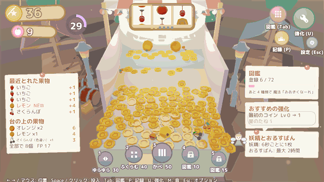
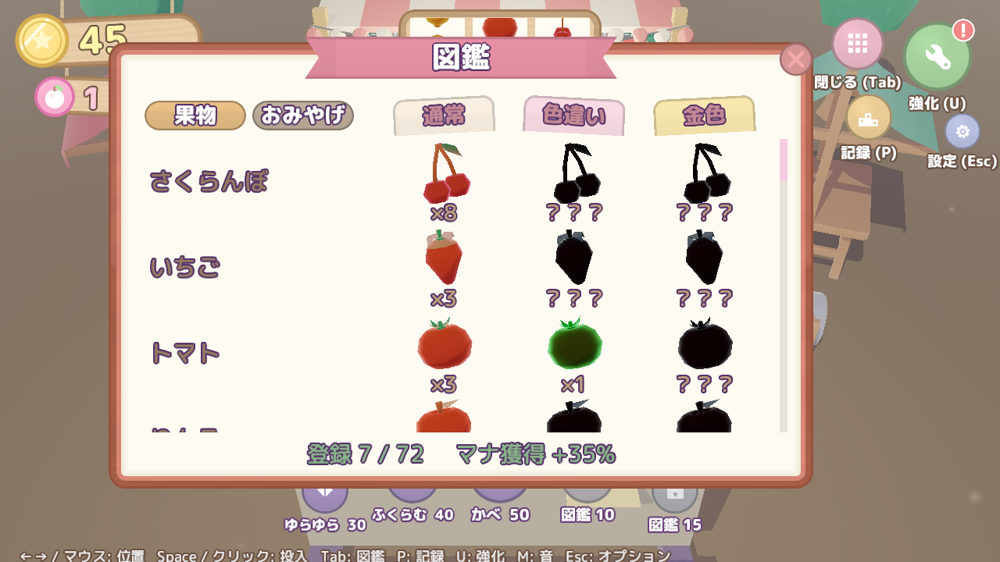
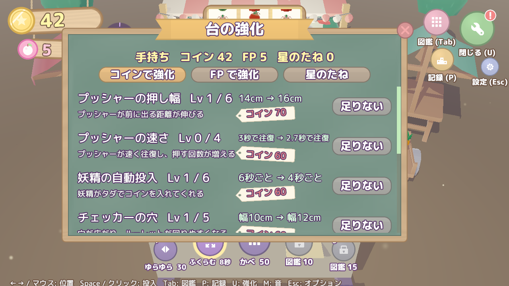
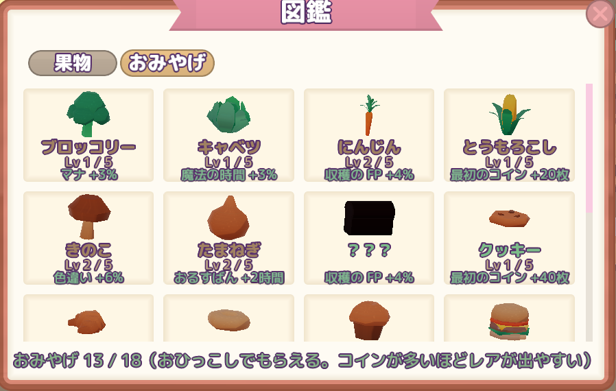

# FruitMagic 🍓🪙

<p>
  
  
  
  <a href="https://github.com/tsukinokun/TsukinoEngine"></a>
  
  
  
  
</p>
<p>
  
  
  <a href="https://qiita.com/tsukino_"></a>
</p>

**魔法の果物屋台のコインプッシャー** — コインを落として果物を押し出し、図鑑を埋め、台を育てる放置・収集型ゲーム。



| | |
|---|---|
| ジャンル | 放置・収集型コインプッシャー（PC） |
| 制作形態 | 個人制作（企画・プログラム・調整） |
| 制作期間 | 2026年10月〜（制作中） |
| 言語・環境 | C++20 / DirectX 11 / Windows / Visual Studio 2022 / Premake5 |
| エンジン | 自作エンジン [TsukinoEngine](https://github.com/tsukinokun/TsukinoEngine)（ECS: EnTT、物理: Jolt Physics） |

## ゲームの特徴

妖精の屋台に置かれた小さなプッシャー台。コインを落とすと台の上の果物が押し出されて手に入ります。
果物で台を育て、図鑑を埋め、ここぞという時に魔法で台を揺らして一気に落とします。

気持ちよさを次の4段階で設計しています。

1. **ジリジリ** — 縁で揺れる果物を見守る緊張感（プッシャーの本質）
2. **ドサッ** — 魔法で一気に崩す爽快感（プレイヤーの能動的な介入）
3. **コレクション** — 新しい果物・レアな色違いが出たときの嬉しさ
4. **成長** — 台が少しずつ豪華・便利になっていく実感

```
コインを投入 → プッシャーが果物とコインを押す
  → 落ちたコインは手持ちへ / 落ちた果物は収穫（図鑑登録・FP）
  → マナが溜まる → 魔法で一気に崩す
  → コイン・FP で台を強化 → 補充される果物が良くなる
```

| 要素 | 内容 |
|---|---|
| 果物と図鑑 | 24種 × 3バリエーション（通常・色違い・金色）＝ 72枠。登録するたびにマナ獲得量が上がる |
| ルーレット | 手前の端で左右に動く穴をコインが通ると3リールのスロットが回り、当たると果物が台に補充される。4% でジャックポットチャンス |
| 魔法 | 5種（ゆらゆら・ふくらむ・かべ・おおきくなーれ・メテオコイン）。図鑑の登録数で覚える |
| 強化 | コインで台の強化 8種、FP で果物と魔法の強化 7種 |
| 放置 | 閉じている間も妖精がコインを入れ、再起動時に「おかえりなさい！」で報酬を受け取る |
| 転生 | 「屋台のおひっこし」でリセットし、星のたねで永続強化 7種。おひっこしのたびに屋台の色が変わり、おみやげ（18種）がもらえる |

<p>
  
  
</p>

### 転生「屋台のおひっこし」と周回の収集要素

育てた台を妖精に引き継ぎ、新しい屋台を一から始める転生システムです。
コイン・FP・強化は最初に戻りますが、**図鑑・覚えた魔法・星のたね・おみやげは残る**ので、周回するほど次の屋台が速く育ちます。

```
屋台を育てる → おひっこし（星のたね・おみやげをもらう）
  → 永続強化と図鑑ボーナスで次の屋台が速い → 図鑑がさらに埋まる → …
```

- **解放**: 果樹の段階 4 以上の果物を図鑑に登録すると、おひっこしできるようになる（自動プレイで約20分）
- **星のたね**: 今回の屋台で収穫した価値の平方根で決まる（稼ぐほど伸びがゆるやかなので、ひとつの屋台で粘り続けるより区切りよく周回したくなる）。永続強化 7 種に使う
- **屋台の色**: おひっこしのたびに、いちご → ミント → レモン → ぶどう → ソーダ → 夜空 と屋台全体の配色が変わり、見た目でも周回の進み具合がわかる

#### おみやげ（18種）

おひっこしのたびに、果物以外の食べ物を 1〜3 個もらえます（今回の屋台で稼いだほど多い）。周回ごとに集める、果物の図鑑とは別の収集要素です。



| レア度 | 出やすさ（重み） | おみやげの例 | 効果の例（1レベルあたり） |
|---|---|---|---|
| 野菜 | 60 | にんじん・きのこ・キャベツ | 収穫の FP +2%、色違い +3% |
| パンとお菓子 | 28 | クロワッサン・ドーナツ | マナ +5%、果物の当たり +1% |
| 料理 | 10 | ハンバーガー・おすし・タコス | FP +7%、星のたね +6% |
| ごちそう | 2 | バースデーケーキ・ローストチキン | 星のたね +12%、FP +15% |

- おひっこし時に**手持ちのコインが多いほどレアが出やすい**（10,000 枚で最大）ので、「おひっこし前にコインを貯めるか、すぐ移るか」の駆け引きが生まれる
- 同じものが出ると**レベルアップ**して効果が伸びる。上限に達したものは出なくなるので、ダブりが無駄にならない
- 図鑑の「おみやげ」タブに 3D モデルで並び、まだ持っていないものは黒いシルエットで出す
- おみやげも果物と同じく `Assets/Data/Souvenirs/<id>.json` を足すだけで増やせる

## 技術アピール

### データ駆動 — 果物は JSON を1つ置くだけで増える
- 果物は1種＝1つの定義（`Assets/Data/Fruits/<id>.json`）。形・重さ・価値・出現の重み・解放条件・モデル・色を持ち、
  図鑑・抽選・解放はすべて定義から組み立てるので、**果物ごとの専用コードはありません**（おみやげも同じ作り）
- 価格・確率・演出・UI の配置や色・文言まで、調整値は `Assets/Data/` の JSON に置き、コードに直書きしない
- セーブは果物・強化を id で保存するので、定義を足しても古いセーブが読めます（形式の版管理、壊れたセーブの退避つき）

### 物理がそのままゲーム性になる
- 1unit＝1cm の世界に合わせて Jolt の重力と接触の許容値を設定（そのままだと重力が 1/100 になり、コインが床に潜った）
- コインの当たり判定を円柱にしたところ、プッシャーの前でコインが乗り上げて押す力が伝わらず、
  **払い出し率が 100% → 8% に落ちた**ため、見た目だけ丸くして当たり判定は箱のままにした
- 落ちた場所は「手前の端と横の端のどちらをより大きく越えたか」で判定し、手前は収穫・横は溝（マナに変換）に振り分け

### 自動プレイでバランスを計測
- 環境変数 `FRUITMAGIC_AUTOPLAY=1` で起動すると自動で遊び、1分ごとに払い出し率・手持ち・強化の時刻などをログに出す
- 数値を変えるたびに回して比べ、例えば M7 の調整では**払い出し率を 72% → 86%** に上げた（10分間の計測で手持ちが 15〜37 枚で推移することを確認）
- 転生の解放（約20分）や星のたねの量も、この計測から決めています

### 放置報酬は期待値で計算
- 閉じていた時間の報酬は物理を回さず、強化値から期待値で計算（妖精が入れたコイン × 戻る割合 など）

### 手触りのある UI
- ボタンのホバー・押し込み・弾み、画面のポップイン、数のカウントアップ、ゲージの追従など、止まっている UI をなくす
- 図鑑やカットインの果物は画像ではなく本物の 3D モデルを UI の層に描画（スクロールに合わせて動かし、枠で切り取る）

### アセットを作るツール
- 効果音・光のテクスチャ・アプリのアイコンは Python で合成（[Tools/](Tools/)）。直したいときはスクリプトを直して作り直す

## 操作方法

| 操作 | キー / マウス |
|---|---|
| 投入する位置 | マウスの左右 / ←→ |
| コインを投入 | クリック / Space |
| 魔法 | 画面下のボタン / 1〜5 |
| 図鑑・強化・記録 | Tab / U / P（または右上のボタン） |
| 消音 | M |
| オプション・閉じる | Esc |

## ドキュメント

- [Docs/GameDesign.md](Docs/GameDesign.md) — 企画書（コンセプト・コアループ・果物・魔法・強化・放置・転生）
- [Docs/Roadmap.md](Docs/Roadmap.md) — マイルストーン M1〜M9 と技術メモ。各マイルストーンを「遊べる状態」で終える進め方で作っています

## ビルド方法

### 必要要件

- Windows 10 / 11（x64）
- Visual Studio 2022（**C++ によるデスクトップ開発**ワークロード）
- Git

### セットアップ

```bash
git config --global core.longpaths true
git clone --recurse-submodules https://github.com/tsukinokun/Fruits-Magic.git
```

クローン済みの場合、またはサブモジュールを取り直したい場合は `setup.bat` を実行します
（サブモジュールの取得と Visual Studio ソリューションの生成を行います）。

```bat
setup.bat
```

### ビルドと実行

```bat
build.bat            :: Debug ビルド（成功時は何も出力しない）
build.bat Release    :: Release ビルド
open.bat             :: .build\FruitMagic.sln を生成して Visual Studio で開く
```

- 実行ファイルは `bin\Debug\FruitMagic.exe` / `bin\Release\FruitMagic.exe`
- Debug ビルドはリポジトリルートを作業ディレクトリとして起動してください
  （Visual Studio から実行する場合は自動でそう設定されます）
- Debug ビルドはエンジンのアセットを絶対パスで参照するため、ソリューションを生成したマシンでのみ動作します。
  Release ビルドは `bin\Release` 以下だけで動作します
- ログは `Logs\FruitMagic.log`、セーブは `Saves\save.json` に出力されます（消すと最初から）

ソースファイルを追加・削除した場合は `build.bat`（または `open.bat`）を実行すると
プロジェクトファイルが再生成されます。

## ディレクトリ構成

```
FruitMagic/
├─ Assets/                  ゲームのアセット
│  └─ Data/                 果物・魔法・強化などの定義 JSON（調整値もここ）
├─ Docs/                    企画書・ロードマップ
├─ FruitMagic/
│  ├─ include/FruitMagic/   ヘッダ
│  └─ src/                  ソース（ECS/System・Game・Scene）
├─ Tools/                   効果音・テクスチャ・アイコンを合成する Python スクリプト
├─ External/TsukinoEngine/  エンジン（サブモジュール）
└─ premake5.lua             ビルド定義
```

## 作者

**山﨑 愛**

- GitHub：[@tsukinokun](https://github.com/tsukinokun)
- Qiita：[@tsukino_](https://qiita.com/tsukino_)

## クレジット

使っている素材とライセンスは [CREDITS.md](CREDITS.md) にまとめています。